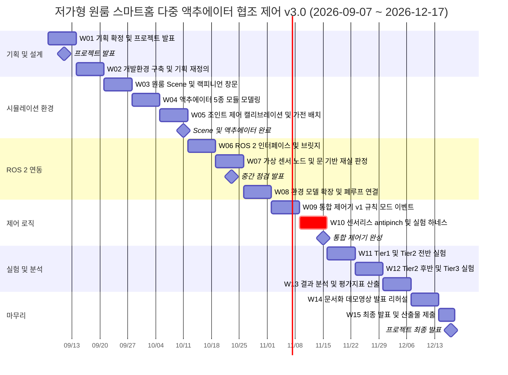

# 프로젝트 일정 계획서 (Master Schedule)

> **프로젝트명:** 1인 가구 원룸을 위한 저가형 스마트홈 다중 액추에이터 협조 제어
> **기간:** 2026-09-07(월) ~ 2026-12-17(목), 총 15주
> **환경:** NVIDIA Isaac Sim + ROS 2
> **핵심 산출물:** 원룸 USD 월드, 가상 센서/액추에이터 · **가전 브릿지** 노드, 센서리스 창문 제어기, **규칙+모드+이벤트** 통합 제어기, 시나리오 40개(237회) 실험 결과
>
> 초판 2026-09-07 · 개정 2026-09-12 v2.1 · 2026-10-05 v3.0 가전 편입 재설계 · **2026-10-05 v3.1 피드백 2**

---

## 0-D. v3.4 — 재실 기본 환기 · 샤워 · 환경 회복 (2026-10-06)

CO₂ 측정 · 계산 폐지 → 재실 기본 환기 · E3 샤워 · E4 기본 환기 미달 · I10 이슬점 비교 배기 · 회복 원칙. 시나리오 38 → **40개 / 234회**(C18 · C19 신설). 일정 영향: W07 +2h(샤워 감지 · I10) · W08 +1h(욕실 습기 발생원) · W09 +2h(회복 오버레이) · W12에 C18 · C19 포함.

## 0-C. v3.3 — 후드 아래 온도 센서 (2026-10-06)

미세먼지 센서 유지 + 후드 아래 온도 센서(DS18B20) 추가 — 요리 감지 · 원인 구분 · 불 켜고 외출 경고. 일정 영향: W05 +0.5h · W07 +3h · W08 +2h. 시나리오 수 · 실행 횟수 변동 없음(B7 · X9 개정).

## 0-B. v3.2 — 문 열림 센서 (2026-10-05)

리드 스위치 문 열림 센서 + 호텔 객실 로직 채택. 일정 영향: **W05 +1h**(현관문 관절) · **W07 +4h**(문 기반 재실 상태 머신). 시나리오 수 · 실행 횟수 변동 없음(B12 · X9 개정).

## 0-A. v3.1 개정 요약 (피드백 2 · 2026-10-05)

| 항목 | v3.0 | **v3.1** |
|---|---|---|
| 판단 신호 | 센서 7종 | **센서 5종 + 휴대폰 Wi-Fi + 기기 전력** (PIR 제거 · CO₂ 가상화) |
| 시나리오 | 32개 / 180회 | **38개 / 216회** + EXP-1(T\* 45회) · EXP-2(예측 모델 비교) |
| 신규 구현 | – | `power_monitor` · `energy_predictor` · 2R2C 열모델 · 빨래 건조 모델 · 우선 목표 예산 |

**주차 구조 불변.** 추가분은 **W07(재실 융합 · 전력 상태 머신) · W09(이벤트 · 예산) · W10(3R3C/2R2C · 마르코프 생성기 · 변화점 회귀) · W11(분위수 회귀 · 열모델 식별 · 프리쿨링 최적화) · W12(T\* 스윕)** 로 나눴다.
W08은 v3.0 증가분이 이미 커서 v3.1은 **기기 전력 프로파일 · 가상 CO₂ · 빨래 건조 모델**만 얹는다.
에너지 실험(EXP-1 · EXP-2)은 **W12까지 결과가 나오지 않아도 핵심 주장(Tier 1–2)에 영향이 없다** — Tier 3와 함께 선택 과제 성격으로 관리한다.

---

## 0. v3.0 개정 요약 (2026-10-05 · W05 첫날)

### 무엇이 바뀌었나

| 항목 | v2.1 | **v3.0** |
|---|---|---|
| 센서 · 액추에이터 | 5부품 · 5종 | **7부품 · 11종** (CO₂ · PM2.5 / 가전 편입 6종) |
| 제어 구조 | 우선순위 규칙 + 자동 모드 | **규칙 + 모드 + 이벤트 · 6계층 중재** |
| 시나리오 | 17개 / 99회 | **32개 / 180회** (물리 36 + 고속 144) |
| 토픽 · 노드 | 25개 · 6종 | **44개 · 8종** |
| 환경 모델 | 온도 · 습도 · 조도 | + **CO₂ · PM · 이슬점 · 창 표면온도 · 공기 수지** |
| 하네스 | Isaac Sim 실행 | **물리 / 고속 2모드** |

### 주차 구조는 이번에도 바꾸지 않는다

개정 시점이 **W05 첫날**이고, 늘어난 작업은 대부분 **조인트가 아닌 환경 모델 · 제어 로직**이다.
가전 6종은 Isaac Sim에서 정적 메시 + 상태 표시로만 표현하므로 **W05 Scene 작업 증가는 작다**(실링팬 · 흡기팬 Revolute 2개).

| 주차 | 추가 작업 | 흡수 방법 |
|---|---|---|
| W05 | 가전 6종 · 센서 2종 배치 | 정적 메시 · emissive 머티리얼만 — 반나절 |
| W06 | 토픽 25 → 44 · `appliance_bridge` | 가전은 IR/릴레이 **이산 명령**이라 브릿지가 단순 |
| W07 | `air_quality_sensor` (CO₂ 1차 지연 · PM) | 센서 모델 2개 — 재실 융합보다 단순 |
| **W08** | **환경 모델 확장** (CO₂ · PM · 절대습도 · 결로 · 공기 수지) | ⚠️ **최대 증가분.** 계수는 문헌값으로 시작, 튜닝 · 민감도 분석은 W13으로 |
| W09 | 모드 관리자 · 이벤트 감지기 · 규칙 엔진 · 중재기 | v2.1 상태 머신을 4모듈로 분해 — 구조는 늘지만 규칙은 표로 관리 |
| W10 | 하네스 **고속 모드** | 고속 모드는 Isaac Sim이 필요 없어 **W08에 먼저 완성** 가능 → W10 리스크 감소 |
| W11–W12 | 180회 실행 | 고속 모드로 **약 11시간** — v2.1의 99회(16.5시간)보다 오히려 짧다 |

---

## 0-1. v2.1 개정 요약

### 무엇이 바뀌었나

| 항목 | v1.0 | **v2.1 (현재)** |
|---|---|---|
| 시나리오 | S1–S7 (7개 / 63회 실행) | **B/C/X 17개 3계층 (99회 실행)** |
| 센서 구성 | PIR + 초음파 등 4종 | **PIR+mmWave 융합 + 전류** 4종 (비용 −39 %) |
| 창문 안전 | 초음파 거리 센서 | **전류 리플 센서리스 anti-pinch** |
| 액추에이터 | 4종 | **5종** (책상 스탠드 추가) |
| 크리티컬 패스 | W05 · W06 | **W05 · W06 + W10 실험 자동화 하네스** |
| 참고문헌 | 없음 | **학술 9편 · 특허 3건 · 표준 5건** ([`05_related_work.md`](05_related_work.md)) |
| 안전 로직 | 제어기 단일 계층 | **2계층 분리** — 로컬(통신 없음) + 상위(정책) |
| 모드 | 조명 전용 | **전역 목표값 세트** (팬 상한·창문/블라인드 정책 포함) |

### 주차 구조는 바뀌지 않았다

**주차 이동이나 일정 연장은 없다.** 각 주차의 *내용*만 갱신했다.
근거: 개정 시점(09/12)이 W01 종료 직전이고, **W02(환경 구축)는 기획 내용과 독립적**이므로
W02를 예정대로 진행하면서 기획 재작성을 병행하면 일정 손실이 0이다.

---

## 1. 일정 요약

| 주차 | 기간 | 단계 | 주요 활동 | 마일스톤 |
|---|---|---|---|---|
| W01 | 09/07 ~ 09/13 | 기획 | 요구사항 확정, **프로젝트 발표**, **피드백 반영 재기획** | 🎤 프로젝트 발표 (09/11) |
| W02 | 09/14 ~ 09/20 | 기획 | 개발환경 구축, 아키텍처 설계 **+ 기획 재정의 병행** | 환경 구축 완료 |
| W03 | 09/21 ~ 09/27 | 환경 | 원룸 Scene 구성 **+ 랙-피니언 창문 구조** | `lowcost_studio_room.usd` v0.1 |
| W04 | 09/28 ~ 10/04 | 환경 | 액추에이터 **5종** 모듈 모델링 | 5종 액추에이터 Prim 완성 |
| W05 | 10/05 ~ 10/11 | 환경 | 조인트 드라이브 설정, 독립 구동, **조도 캘리브레이션** **+ 가전 6종 · 센서 2종 배치 (v3.0)** | ✅ Scene·액추에이터 완료 (10/11) |
| W06 | 10/12 ~ 10/18 | 연동 | ROS 2 토픽 **53개** 인터페이스, `isaac_actuator_bridge` **+ `appliance_bridge`** | 명령 토픽 → 조인트 · 가전 구동 |
| W07 | 10/19 ~ 10/25 | 연동 | 가상 센서 노드 **(문 이벤트 재실 판정 / 전류 합성 / PM · 후드 아래 온도)** | 🎤 중간 점검 (10/23) |
| W08 | 10/26 ~ 11/01 | 연동 | 환경 상태 모델 **(온도 · 절대습도 · PM · 결로 · 공기 수지 · CO₂ 참값)**, 폐루프 연결, **하네스 고속 모드** | 센서↔액추에이터 폐루프 성립 |
| W09 | 11/02 ~ 11/08 | 제어 | 통합 제어기 v1 — **규칙 + 모드 + 이벤트 · 수단 사다리 · 6계층 중재** | `smart_home_controller_node` v1 |
| W10 | 11/09 ~ 11/15 | 제어 | **센서리스 anti-pinch 구현** + **실험 자동화 하네스 (물리 모드 · 2모드 통합)** ⭐ | ✅ 통합 제어기 완성 (11/15) |
| W11 | 11/16 ~ 11/22 | 실험 | **Tier 1(B1–B12) + Tier 2 전반(C1–C7)** + **EXP-2 귀가 예측 · EXP-4 열모델 식별** | B·C 전반 로그 확보 |
| W12 | 11/23 ~ 11/29 | 실험 | **Tier 2 후반(C8–C19) + Tier 3(X1–X9)** + **EXP-1 T\* 스윕** + 조도 모델 대조 | 전 시나리오 + 비교 데이터 |
| W13 | 11/30 ~ 12/06 | 분석 | 평가지표 **16종** 산출, 센서 vs 센서리스 분석, 환경 모델 민감도, **기본 환기량 민감도(EXP-3) · T\* 표** | 결과 분석 리포트 |
| W14 | 12/07 ~ 12/13 | 마무리 | 문서화, 데모 영상, 발표자료, 리허설 | 발표자료 v1.0 |
| W15 | 12/14 ~ 12/17 | 마무리 | **프로젝트 최종 발표**, 산출물 제출 | 🏁 최종 발표 (12/17) |

---

## 2. 단계별 구성

| 단계 | 주차 | 내용 |
|---|---|---|
| Phase 0. 기획·설계 | W01–W02 | 요구사항·범위·아키텍처 + **피드백 반영 재기획** |
| Phase 1. 시뮬레이션 환경 | W03–W05 | Scene 구성 / 액추에이터 5종 / 독립 구동 + 캘리브레이션 |
| Phase 2. ROS 2 연동 | W06–W08 | 브릿지 / 센서 노드 / 환경 상태 모델 |
| Phase 3. 제어 로직 | W09–W10 | 협조 제어기 / **센서리스 안전 + 실험 하네스** |
| Phase 4. 실험·분석 | W11–W13 | 시나리오 40개 · 237회 / 결과 분석 |
| Phase 5. 마무리 | W14–W15 | 문서화·발표 |

---

## 3. 간트 차트 (Mermaid)



---

## 4. 마일스톤

| # | 일자 | 마일스톤 | 판정 기준 |
|---|---|---|---|
| M1 | 2026-09-11 | 프로젝트 발표 | 기획안·범위·일정 확정 → **완료. 피드백 3건 접수 후 v2.0/v2.1 재기획** |
| M2 | 2026-10-11 | Scene·액추에이터 완료 | **5종** 액추에이터가 독립 구동 + 조도 캘리브레이션 완료 + **가전 6종 · 센서 2종 Prim 배치** |
| M3 | 2026-10-23 | 중간 점검 | 센서 토픽 발행 + 명령 토픽 구동 시연 + **문 기반 재실 판정 동작** |
| M4 | 2026-11-15 | 통합 제어기 완성 | **40개 시나리오가 하네스(물리 · 고속)로 자동 실행되어 오류 없이 완주** |
| M5 | 2026-12-17 | 프로젝트 최종 발표 | 데모 영상 + 정량 결과 + 최종 보고서 제출 |

---

## 5. 크리티컬 패스

```text
W03 Scene → W04 액추에이터 조인트 → W05 독립 구동·캘리브레이션
   → W06 ROS 2 브릿지 → W08 폐루프 → W09 통합 제어기
   → ⭐ W10 실험 자동화 하네스 → W11/W12 시나리오 237회 → W13 분석 → W15 최종 발표
   (v3.0 병렬 경로: W08 환경 모델 확장 → W08 하네스 고속 모드 → W09 규칙·모드·이벤트)
```

### ⚠️ 신규 최대 리스크 — W10 실험 자동화 하네스

시나리오가 7개(63회) → 17개(99회) → 32개(180회, v3.0) → **40개(237회, v3.4)** 로 늘었다. **수동 실행은 불가능하다.**

| 항목 | 값 |
|---|---:|
| 총 실행 횟수 | **237회** (물리 36 + 고속 201) + 별도 실험 EXP-1 45회 · EXP-3 18회 |
| 1회 소요 | 물리 10분 · 고속 ~2분 |
| 총 소요 | **약 12.7시간** (물리 6.0 h + 고속 6.7 h) · EXP 포함 약 14.8시간 |
| 야간 배치 가정 | 2일 |

**하네스(`scripts/scenario_runner.py`)가 W10에 나오지 않으면 W11–W12가 무너진다.**
기존 위험 구간(W05 조인트 튜닝, W06 브릿지)에 더해 **이것을 최우선 리스크로 관리한다.**

**안전장치**
- W13 후반 3일 버퍼 유지
- **Tier 3(X1–X9) 9개는 선택 과제** — W12 종료 시점에 여유가 없으면 X5–X8부터 잘라낸다. Tier 1+2(**31개, 210회**)만으로도 핵심 주장은 입증된다
- **v3.0:** 고속 모드(144회)는 Isaac Sim 없이 돌므로 **W08에 먼저 완성**해 하네스 리스크를 분산한다
- 하네스는 W09 착수 시점에 **골격만이라도 먼저 만들어** 진행률을 조기에 가시화한다

---

## 6. 리스크 관리

| 리스크 | 영향 | 대응 |
|---|---|---|
| ⭐ **실험 자동화 하네스 지연** | **W11–W12 실험 붕괴** | **고속 모드 W08 선행 완성**, 물리 모드 W10, Tier 3 선택 과제화 |
| **[v3.0] 환경 모델 확장 과부하** | W08 지연 → 폐루프 · 고속 모드 지연 | 계수 config 분리 · 문헌값으로 시작 · 튜닝/민감도는 W13 · **C9/C10 핵심 수식(공기 수지 · 결로)부터** 구현 |
| **[v3.0] 가전 효과 계수의 타당성 의심** | 가전 시나리오 결과 신뢰도 저하 | 정격 사양 · 문헌값 근거 명시, 침기량 · 후드 포집률 민감도 분석 (W13) |
| Isaac Sim ↔ ROS 2 브릿지 연결 실패 | 전체 일정 지연 | W02에 PoC 선행 검증, 실패 시 파일 기반 IPC 대체 |
| **Effort Sensor API 가용성 불확실** | 센서리스 구현 불가 | W02 환경 구축 시 `isaacsim.sensors.experimental.physics` 경로 즉시 검증. 대체안: `get_measured_joint_forces()` |
| **리플 합성 모델의 타당성 의심** | 센서리스 결과 신뢰도 저하 | 무엇이 물리 검증이고 무엇이 모사인지 문서에 명시. 접촉 반력은 Contact Sensor 실측으로 뒷받침 |
| **저속 구간 끼임 미검출** | 안전 지표 미달 | Zone B 종료 토크(55 %)를 W12에서 스윕하여 최적값 확정 |
| 조인트 물리 파라미터 불안정 | 실험 데이터 품질 저하 | 드라이브 stiffness/damping 스윕, 속도 제한 적용 |
| 환경 상태 모델이 비현실적 | 평가 지표 신뢰도 저하 | 계수를 config로 분리, 문헌값 기반 튜닝 후 민감도 분석 |
| 조도 해석 모델 신뢰도 의심 | 조도 지표 신뢰도 저하 | W12에 카메라 기반 상대 휘도 대조 1회 수행 |
| GPU/렌더링 성능 부족 | 실시간 시뮬레이션 불가 | RTX 실시간 모드, headless 실행, 물리 dt 조정 |
| 실험 재현성 부족 | 결과 비교 불가 | `scenario_profiles.yaml` 시드 고정, 로그 자동 저장 |

---

## 7. 산출물 체크리스트

### 문서 (Phase 0)
- [x] `docs/00_project_schedule.md` — 마스터 일정 **v2.1**
- [x] `docs/01_project_brief.md` — 기획 요약 **v2.1**
- [x] `docs/02_scope_definition.md` — 범위 정의서 **v2.1**
- [x] `docs/03_scenarios.md` — **시나리오 명세서 17개 (신규)**
- [x] `docs/04_sensorless_window_control.md` — **센서리스 창문 제어 설계서 (신규)**
- [x] `docs/05_related_work.md` — **선행연구 및 참고문헌 (신규 v2.1)**
- [x] `config/thresholds.yaml` — 제어 기준값 **v3.0**
- [x] `docs/06_appliance_integration.md` — **가전 편입 설계서 (v3.0 신규)**
- [x] `docs/07_modes_rules_events.md` — **규칙 + 모드 + 이벤트 (v3.0 신규)**
- [x] `config/user_modes.yaml` — **사용자 모드 (v3.0 신규)**
- [x] `docs/08_multisignal_energy.md` — **다중 신호 · 전력 상태 · 에너지 예측 (v3.1 신규)**
- [x] `docs/presentation/feedback2_review.md` — **피드백 2 · 팀원 아이디어 검증 보고서**

### 시뮬레이션 (Phase 1)
- [ ] `worlds/lowcost_studio_room.usd` — 원룸 월드
- [ ] `assets/actuator_models/` — 창문(랙-피니언)·블라인드·팬·천장조명·스탠드
- [ ] `assets/appliance_models/` — **에어컨 · 제습기 · 가습기 · 실링팬 · 흡기팬 · 청정기 · 후드 (v3.0)**
- [ ] `config/actuator_limits.yaml`
- [ ] `config/lighting_calibration.yaml` — W05 캘리브레이션 결과

### ROS 2 노드 (Phase 2–3)
- [ ] `scripts/isaac_actuator_bridge.py`
- [ ] `scripts/environment_state_node.py` — 온도 · 절대습도 · PM · 결로 · 공기 수지 (CO₂는 검증용 참값) — 순수 Python 코어 `scripts/env_model/`를 감싼다
- [ ] `scripts/occupancy_sensor_node.py` — **문 이벤트 + 판정 창 3분 (호텔 로직)** · 폴백 융합
- [ ] `scripts/window_current_node.py` — **전류 합성 + 리플 카운팅 (신규)**
- [ ] `scripts/smart_home_controller_node.py` — 협조 제어 + **센서리스 anti-pinch**
- [ ] `scripts/controller/` — **mode_manager · event_detector · rule_engine · means_ladder · arbiter (v3.0)**
- [ ] `scripts/appliance_bridge_node.py` — **IR · 릴레이 추상화 · 가전 보호 · IR 역확인 (v3.0)**
- [ ] `scripts/air_quality_sensor_node.py` — **PM2.5 · 후드 아래 온도 (v3.4: CO₂ 삭제)**
- [ ] `scripts/power_monitor_node.py` — **기기 전력 상태 머신 (v3.1)**
- [ ] `scripts/energy_predictor_node.py` — **귀가 분위수 · 열모델 식별 · 변화점 회귀 · 프리쿨링 최적화 (v3.1)**
- [ ] `config/environment_model.yaml` — **환경 · 가전 효과 계수 (v3.0)**
- [ ] `scripts/experiment_logger_node.py`
- [ ] `launch/studio_smart_home.launch.py`

### 실험 (Phase 4)
- [ ] ⭐ `scripts/scenario_runner.py` — **실험 자동화 하네스 (신규 · 크리티컬)**
- [ ] `config/scenario_profiles.yaml` — 시나리오 **40개** 정의 (스키마 v2.0)
- [ ] `results/raw/*.csv` — **237회** 원시 로그
- [ ] `results/summary.csv` — 지표 **16종** 집계
- [ ] `results/figures/` — 그래프·표

### 마무리 (Phase 5)
- [ ] 최종 보고서 / 발표자료 / 데모 영상

---

## 8. Figma 연동

- **간트차트 (Figma Design, 메인):** https://www.figma.com/design/rc0ZUsVZyWFtE7ANccryK9
  - 6개 단계 블록을 색상으로 구분한 한눈에 보는 요약형 간트차트
  - 마일스톤 5개(발표·점검·완료 시점)를 세로 가이드라인으로 표시
- **상세 간트차트 (FigJam, 주차 단위):** https://www.figma.com/board/ifDXNuQtjrxM6akQKJhAeu
- **W02 발표자료 (Figma Slides, 17장 / 15:00) — v2.1:** https://www.figma.com/slides/Wfy4nSGRJxxnW34RUvRYB3
- **피드백 2 반영 발표 (Figma Slides, 19장) — v3.1:** https://www.figma.com/slides/oNdg9iU5NSZiNigikV5py6
- **W01 발표자료 (Figma Slides, 20장) — v1.0 기록:** https://www.figma.com/slides/dKaN1pbrEsOu0C1Ok4URij

### 단계별 색상 코드

| 단계 | 주차 | 색상 | HEX |
|---|---|---|---|
| PHASE 1 · 기획 · 설계 | W01–W02 | 스톤 | `#78716C` |
| PHASE 2 · 시뮬레이션 환경 | W03–W05 | 틸 | `#0D9488` |
| PHASE 3 · ROS 2 연동 | W06–W08 | 올리브 | `#4D7C0F` |
| PHASE 4 · 제어 로직 | W09–W10 | 골드 | `#CA8A04` |
| PHASE 5 · 실험 · 분석 | W11–W13 | 오렌지 | `#EA580C` |
| PHASE 6 · 마무리 | W14–W15 | 레드 | `#DC2626` |

> 팔레트: **그래파이트 + 시그널 라임** — 배경 `#131518` / `#FAFAF9` · 액센트 `#A3E635`(다크) `#65A30D`(라이트)
> 6단계 색상은 **틸 → 올리브 → 골드 → 오렌지 → 레드** 유사색 램프로, 시간 진행이 색으로 읽힌다.
> 상세: W02 발표 구성안 §3.5 (v2.1 기록 — 저장소에서 제외, 로컬 `_archive/` 보관)

> 일정이 변경되면 이 문서의 Mermaid 간트를 먼저 수정한 뒤, 동일 내용을 Figma 파일에 반영한다.

### ⚠️ Figma 반영 대기 항목 (v2.0)

- [x] W10 블록을 **크리티컬 표시**로 강조 ✅
- [x] 단계 설명 라벨 v2.1 갱신 ✅
- [ ] 발표자료에 **참고문헌 슬라이드** 추가 (선행연구 대비표)
- [ ] 발표자료 슬라이드 7·8(센서·액추에이터), 13·14(핵심 차별점), 16(검증 계획) 갱신
- [ ] **[v3.0] W02 발표자료(v2.1)를 가전 편입 기준으로 갱신** — 다음 발표(중간 점검 10/23) 전

---

## 변경 이력

| 일자 | 버전 | 내용 |
|---|---|---|
| 2026-09-07 | v1.0 | 초판 |
| 2026-09-12 | **v2.0** | W01 발표 피드백 3건 반영. 시나리오 16개(90회) · 센서 최소화 · 센서리스 전환 반영. **주차 구조 불변, 내용만 갱신.** W10 실험 자동화 하네스를 신규 크리티컬 패스로 지정 |
| 2026-09-12 | **v2.1** | 선행연구 정리 반영 — 참고문헌 정립(`05_related_work.md`) · 안전 2계층 분리 · 모드 전역화 · **C8(미세먼지) 추가 → 17개/99회** · 2단 제어 주기 |
| 2026-10-05 | **v3.0** | **가전 편입 재설계** (W05 첫날). 센서 7 · 액추에이터 11 · 규칙+모드+이벤트 · 시나리오 32개/180회 · 하네스 물리/고속 2모드. **주차 구조 불변** — W05·W06·W07 소폭, **W08 환경 모델 확장이 최대 증가분**, 고속 모드를 W08로 앞당겨 W10 리스크 분산 |
| 2026-10-05 | **v3.1** | **피드백 2** — 판단 신호 재구성(PIR 제거 · Wi-Fi · 전력 · 가상 CO₂) · 우선 목표 예산 · 에너지 예측 · 시나리오 38개/216회 · EXP-1/2. 주차 구조 불변, 추가분을 W07 · W09 · W10 · W11 · W12로 분산 |
| 2026-10-09 | v3.4.1 | 최신 계획 정합 — 시나리오 40개 · 237회 · 지표 16종으로 수치 갱신 · W07 · 산출물의 PIR 융합 → 문 이벤트 재실 판정 · CO₂ 센서 노드 삭제 반영 (v3.2–v3.4 요약 행은 §0-B–§0-D에 기존 기재) |
