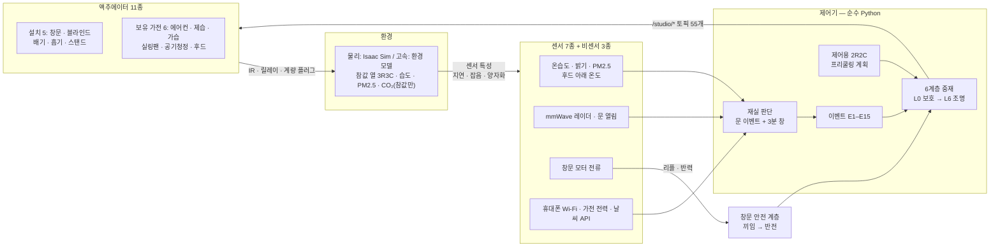
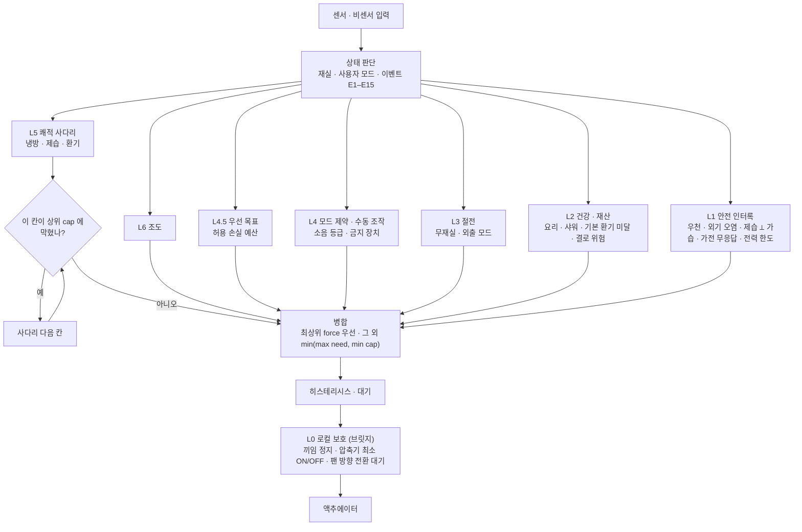

# 최종 보고서 초안 — 1인 가구 원룸을 위한 저가형 스마트홈 다중 액추에이터 협조 제어

> W14 T14.2 · 초안 **v1.2** (2026-10-30) · 난방 확장 §6.14 (브랜치 `heating` · docs/14 · docs/15) · 요약판 [`report_summary.md`](report_summary.md) · 제어기 v1.29 (동결 2026-10-25 · `config/freeze.yaml`)
> 모든 결과는 **시뮬레이션**이다 · 수치 출처: 요약 보관 [`archive/v1.29/`](../archive/v1.29/README.md) (커밋됨) · 기록 [`docs/12`](12_freeze_record.md)
> 통과율 구간 = **시나리오 묶음 부트스트랩 95 %** (같은 시나리오의 반복은 서로 닮았다 — 실행 독립 가정 Wilson 구간보다 넓다)

---

## 0. 요약

국내 원룸(3.5 × 5 m)에 이미 있는 가전(에어컨 · 제습기 · 가습기 · 공기청정기 · 레인지후드 · 실링팬)과 저가 리트로핏 장치(창문 모터 · 블라인드 · 배기팬 · 흡기팬 · 스탠드)를 **센서 7종과 비센서 신호 3종**으로 묶고, 목표가 서로 충돌할 때 수단을 바꿔 쓰는 **규칙 + 모드 + 이벤트 기반 협조 제어기**를 만들어 NVIDIA Isaac Sim · ROS 2 가상 원룸에서 검증했다.

**핵심 메시지**
1. 협조 제어는 목표 충돌 상황에서 실내 환경 결과를 크게 더 잘 지킨다 — **상용 스마트홈 허브 수준의 규칙 자동화(A′)보다 환경 결과 통과율 +60 %p** (무작위 반복 · 같은 조건 짝 · 구간 [+35, +84])
2. 같은 조건에서 A′ 보다 **쾌적까지 포함한 기대비용이 약 30 % 낮다** (구간 1 아래). 에너지만으로는 −16–18 % 지만 **구간이 1 을 포함해 불확실**하다. 기기별 내장 자동(A)보다는 에너지를 더 쓴다 — A 는 쾌적을 거의 지키지 못하기 때문이다
3. 사전 등록한 처음 보는 조합에서 **89 %**, 센서 결함을 넣어도 **87 %**, 임계값을 ±20 % 흔들어도 환경 결과는 그대로였다. 물리 모드는 고정 조건 24/24 → **조건 무작위 20/24**

| 질문 | 결과 (제안) |
|---|---|
| 판정 기준을 더 잘 지키나 | 무작위 반복 **95.8 %** [90.9, 99.4] vs A 10.0 % · A′ 11.1 % · B 78.9 % · 실측 기상(서울 2024) **93.9 %** [89.1, 98.2] |
| 환경 결과만 보면 (A 가 도는 시나리오만 짝) | 무작위 제안 91.2 % · A′ 31.2 % · A 23.8 % · B 76.2 % |
| 처음 보는 조합 | 보류 평가 7차(마지막 · 사전 등록 · 결과 고치지 않음) **32/36 (89 %)** [72, 100] |
| 에너지 · 비용 (A′ 대비 · 같은 조건 짝) | 기대비용 **0.69** [0.58, 0.87] · 에너지 0.84 [0.64, 1.10] (불확실) · 쾌적 유지율 A′ 0.60 · 제안 0.62 |
| 견고성 | 센서 결함 86.7 % · 임계값 ±20 % 88.5 % (환경 결과 93.6 % 그대로) · 물리 조건 무작위 20/24 |
| 외부 에뮬레이터 | BOPTEST (에어컨만) — 제안 · A · A′ 열 불쾌 같음 · B 보다 8–9 % 적음 |
| 외출 냉방 학습 비교 (EXP-5) | 학습 4주에서 LSTM · 데이터 기반 강화학습은 현재 방식과 차이 없음 · **단순 '언제나 끄기' 가 모든 방식보다 쌈** (한계 15 · §6.13) |
| 확장 — 난방 통합 (§6.14) | 온수 바닥난방 · 가스보일러에서 A · A′V(24시간 환기) 대비 **환경 결과 낫다** (+0.24 – +0.38) · 난방 기대비용은 차이를 확인하지 못함 · 사후 개선으로 같은 데이터 통과 72 → 79 |
| 창문 끼임 | 끼임 감지 165/165 (스윕) · 오검출 0/20 · 최대 접촉력 52.9 N (스윕) · 86.5 N (시나리오) — 100 N 미만 |

### 0.1 용어
| 용어 | 뜻 |
|---|---|
| **A** | 기기별 독립 운전 — 가전 내장 자동 + 사용자 행동 모델(후드를 2분 늦게 켬 · 나갈 때 에어컨 끔 등) |
| **A′ (A2)** | 상용 스마트홈 허브 수준 규칙 자동화 — 기기마다 '조건 → 동작' 규칙 · 히스테리시스 있음 · 협조 없음 (사전 명세 docs/12 §19) |
| **B** | 제안과 같은 제어기에서 히스테리시스 · 대기만 뺀 것 (채터링 비교용) |
| **제안** | 본 연구의 협조 제어기 (v1.29) |
| **통과 (실행)** | 한 번의 실행이 그 시나리오의 판정 기준을 **모두** 지킴 |
| **환경 결과 · 수단 · 과정 기준** | 판정 기준 3분류 (§5.3) — 기준선 비교의 주 지표는 환경 결과 기준 통과율 |
| **기대비용** | 전력량 [Wh] + 2,000 × 온도 불쾌 [K·h] (제어기 계획기와 같은 정의) |

---

## 1. 서론

### 1.1 문제
1인 가구 원룸은 한 공간에서 요리 · 샤워 · 빨래 건조 · 수면 · 공부가 모두 일어나, 실내 환경 목표가 자주 충돌한다. 요리 연기를 빼려 후드를 켜면 음압으로 바깥 미세먼지가 들어오고, 빨래를 말리려 제습기를 켜면 여름엔 방이 더워지며, 겨울에 가습하면 창에 결로가 생긴다. 상용 스마트홈은 기기마다 따로 자동 운전하거나 단순 규칙을 이어 붙이므로 이런 충돌을 다루지 못한다.

### 1.2 목표
- 이미 있는 가전을 **IR · 계량 플러그 · 릴레이**로 연결하고, 센서는 물리적으로 대체할 수 없는 것만 더한다 (부품비 약 137,300원 · 가전 구매 0원)
- 목표마다 수단을 비용 순으로 세우고(**수단 사다리**), 제약이 한 칸을 막으면 다음 수단으로 넘어가는 협조 제어
- 창문 끼임 · 위치를 별도 센서 없이 **모터 전류 리플과 반력**으로 판단 (센서리스)

### 1.3 기여
1. 제약 충돌 개수로 계층화한 시나리오 41개와, 같은 판정 문법으로 두 실행 모드(물리 Isaac Sim / 고속 환경 모델)를 돌리는 **하네스** — 제어기 · 센서 특성 · 가전 보호는 두 모드가 같은 코드
2. 규칙 10개 · 이벤트 15종 · 사용자 모드 6종 · 6계층 중재로 표현한 협조 제어기
3. **평가 절차의 신뢰성 장치** — 판정 동결 · 사후 개정 병기 · 무작위 반복 · 실측 기상 · 사전 등록 보류 평가 7차 · 외부 에뮬레이터 · 상용 수준 기준선 · 판정 3분류 · 묶음 부트스트랩 · 센서 결함 · 임계값 민감도 · 물리 조건 무작위 · 모드 대조 (§5)
4. 평가 장치를 하나씩 더할 때마다 드러난 **결함 유형** (§7.1)

---

## 2. 관련 연구 (상세 docs/05 · docs/10 · docs/11 §2–4)

**규칙 기반 다중 장치 제어.** 상용 스마트홈과 다수의 HVAC · 조명 통합 제어는 '조건 → 동작' 규칙이나 상태 머신으로 기기를 묶는다. 이 방식은 해석이 쉽고 기기 추가가 간단하지만, 규칙이 기기마다 따로 있어 한 목표를 위한 동작이 다른 목표를 해치는 경우(후드 배기 → 음압 → 외기 미세먼지 유입)를 다루지 못한다. 본 연구는 같은 규칙 계열이지만, 이미 있는 가전을 IR · 계량 플러그로 편입하고 시나리오를 **제약 충돌 개수로 계층화**해, 충돌이 있을 때 수단을 바꾸는 중재 구조를 명시적으로 평가한다. 상용 허브 수준 규칙 자동화를 기준선 A′ 로 사전 명세해 직접 비교했다 (docs/12 §19).

**학습 · 최적화 기반 제어.** 모델 예측 제어(MPC)는 건물 제어에서 가장 많이 연구된 최적화 방식이고 [5], 강화학습(RL)은 모델 없이 정책을 학습하는 대안으로 주목받는다 [6]. 같은 가상 건물에서 RL 3종과 MPC 를 비교한 연구 [1], 실주택에서 RL 과 MPC 를 한 달 운영해 비교한 연구 [2], 최적 제어 기법들을 정리한 비교 [3] 가 있으며, 이런 비교는 건물 · 기상 · 평가 지표가 다르면 결과를 서로 맞대기 어렵다. BOPTEST [4] 는 이를 위한 표준 테스트 환경이며, 본 연구는 제어기의 에어컨 부분을 BOPTEST BESTEST Air 에 붙여 순위를 외부에서 확인했다 (§6.10). 실내 온도 예측에서 회색상자 모델과 신경망을 비교한 연구도 있으며 [7], 본 연구는 제어용 2R2C 회색상자 모델을 쓰고, 학습 기반 방식과의 직접 비교는 EXP-5 에서 했다 (§6.13).

**센서리스 끼임 감지.** 자동차 전동 창문은 모터 속도 · 전류의 변화로 끼임을 감지하고 반전하는 방식이 오래 쓰여 왔다 [12]. 본 연구는 이를 건물 창문 모터에 옮겨 전류 리플로 위치를, 리플 · 반력으로 끼임을 판단하고 시뮬레이션에서 검증했다. 접촉력 기준은 FMVSS 118 의 100 N 만 차용했으며 [10], 반전 거리 요건은 충족하지 않으므로 건물 창 · 문 구동 장치 표준 [11] 적합은 주장하지 않는다.

**재실 판단 · 환기.** 재실 판단은 PIR · Wi-Fi · 다중 센서 융합이 일반적이지만, 원룸은 정지 재실(수면 · 공부)이 길어 움직임만으로는 재실을 놓치기 쉽다. 본 연구는 문 이벤트 뒤 3분 판정 창(호텔 로직)과 mmWave 레이더로 판단하고, 문 센서 고장 시 24시간 융합으로 폴백한다. 실내 CO₂ 는 인지 수행에 영향을 준다는 보고가 있으나 [14], 저가 구성에서 CO₂ 센서를 빼고 재실 중 모드별 기본 환기량을 늘 공급하는 방식으로 대신했으며, CO₂ 는 시뮬레이션 참값으로만 확인했다.

---

## 3. 시스템 설계

### 3.1 구성
| 구분 | 내용 |
|---|---|
| 센서 7종 | 온습도 · 밝기 · mmWave 레이더 · 문 열림 · 창문 모터 전류 · PM2.5 · 후드 아래 온도 (PIR · CO₂ 센서 없음) |
| 비센서 신호 | 휴대폰 Wi-Fi · 가전 전력(계량 플러그) · 날씨 공공데이터 API |
| 액추에이터 11종 | 설치 5 (창문 · 블라인드 · 배기팬 · 흡기팬 · 스탠드) + 보유 가전 6 (에어컨 · 제습기 · 가습기 · 실링팬(조명 일체) · 공기청정기 · 레인지후드) · 플러그형 인덕션 차단 릴레이 |
| 인터페이스 | ROS 2 토픽 55개 (계약 · docs/02 §6) + 내부 5 |

**그림 A. 시스템 구성** — 센서 · 비센서 신호 → 판단 → 중재 → 액추에이터. 물리 모드와 고속 모드는 아래 '환경' 칸만 바뀌고 나머지는 같은 코드다.

CO₂ 는 제어에 쓰지 않는다. 재실 중 모드별 기본 환기(일반 25 · 공부 40 · 수면 16 m³/h)를 늘 공급하고, CO₂ 는 시뮬레이션 참값으로만 확인한다.

### 3.2 제어 구조 — 규칙 + 모드 + 이벤트 (docs/07)
- **사용자 모드 6종** (NORMAL · STUDY · NIGHT · SLEEP · AWAY · AUTO) — 목표 온습도 · 조도 · 소음 등급 · 기본 환기량
- **이벤트 15종** — 요리 · 결로 · 샤워 · 환기 부족 · 비 · 외기 오염 · 귀가 · 외출 · 가전 이상 · 빨래 건조 · 전력 한도 · 수동 조작 · 프리쿨링 · 재실 오판 · 불 켜고 외출
- **상호작용 규칙 10개** — I1 제습 ⟂ 가습 · I2 냉방 중 창문 제한 · I3 배기 시 급기 확보 · I4 가습 상한 = f(결로 여유) · I5 실링팬 체감 보상 · I6 계절별 제습 수단 · I7 외기 오염 시 필터 급기 양압 · I8 전력 한도 차단 순서 · I9 수동 조작 존중 · I10 환기 제습은 바깥이 더 건조할 때만
- **6계층 중재** — L0 가전 보호 · L1 안전 · L2 이벤트 · L3 외출 · 에너지 · L4 수동 · L4.5 우선 목표 · L5 쾌적 사다리 · L6 조명
- **수단 사다리** — 냉방: 차광 → 창문 → 실링팬 → 배기 + 흡기 → 에어컨 · 제습: 창문 → 배기 → 계절 수단(여름 에어컨 · 겨울 제습기)

**그림 B. 제어 주기 1회의 흐름** (docs/07 §5) — 각 계층이 장치별 후보 명령(force 강제 · cap 상한 · need 필요)을 내고, 병합 규칙이 최종값을 정한다. 쾌적 사다리는 제약이 한 칸을 막으면 다음 칸으로 넘어간다. 브릿지의 L0 보호는 그 뒤에서 상위 명령을 무시할 수 있다.

### 3.3 센서리스 창문 (docs/04)
2계층 — 브릿지 로컬 컷오프(전류 1.80 A · 정지만) + 상위 안전 계층(0.25 A · 속도 저하 → 반전 50 mm · 30 s 유지 · 방향 잠금). 위치는 정류 리플을 세어 추정한다.

---

## 4. 구현

| 항목 | 내용 |
|---|---|
| 환경 | Isaac Sim 5.1 [13] · ROS 2 Jazzy · Python 3.12 · RTX 5070 Ti (SETUP.md) |
| 실행 모드 | **물리** (Isaac Sim 실시간 · 조인트 · 끼임이 필요한 8개) / **고속** (환경 모델 + 제어기 · 33개) |
| 열모델 | 참값 3R3C (공기 · 축열 · 외피) / 제어용 2R2C (기록 데이터로 식별) — 참값과 제어용을 분리 |
| 센서 특성 | 1차 지연 · 가우시안 잡음 · 양자화 (`config/sensor_models.yaml`) · 선택: 편향 · 드리프트 · 이상값 · 끊김 |
| 가전 보호 L0 | 압축기 최소 ON 300 s / OFF 180 s · 제습 ⟂ 가습 · 실링팬 방향 전환 대기 |
| 하네스 | 시나리오 → 주입 · 이벤트 시간표 → 실행 → 동결된 판정 문법으로 채점 · 실행 기록(`manifest.json`) |
| 단위 테스트 | 168개 (`uv run pytest`) |

---

## 5. 실험 방법

### 5.1 시나리오 · 비교군 · 지표
- 시나리오 41개 — Tier 1 단일 조건 12 · Tier 2 두 제약 충돌 19 · Tier 3 세 제약 · 예외 경계 9 + C3b · 총 249회
- 비교군 A · A′ · B · 제안 (§0.1) — A · A′ 는 Tier 2 등 A 를 돌리는 시나리오에서만 (동결된 시나리오 파일을 고치지 않고 `extra_baselines` 로 A′ 를 붙였다)
- 평가 지표 16종 (docs/03 §7)

### 5.2 평가 신뢰성 장치
| 장치 | 내용 |
|---|---|
| 판정 · 지표 동결 | 해시 동결(`config/freeze.yaml`) · 사후 개정은 전후 결과를 함께 적는다 (docs/12) |
| 무작위 반복 | 반복마다 참값 계수(침기 · U값 · 열용량 · COP · 포집률)와 외기를 뽑는다 · 33개 × 5 · 같은 조건 짝 비교 |
| 실측 기상 | ERA5 재분석 [8] 서울(Open-Meteo [15]) — 학습 2021–2023 · **평가 2024** · 시나리오마다 전제와 가까운 날 5일 |
| 보류 평가 | 제어기를 동결한 뒤 새 시나리오 묶음(12개)을 **실행 전에 커밋 · 해시 등록** → 한 번 실행 · 7차를 마지막으로 정하고 결과를 고치지 않았다 |
| 외부 에뮬레이터 | BOPTEST [4] BESTEST Air (Modelica FMU · 48 m² · 덴버 기상 · 각 14일 냉방 2기간) |
| 상용 수준 기준선 A′ | 결과를 보기 전에 규칙 · 값을 정해 커밋 (docs/12 §19) |
| 판정 3분류 | §5.3 |
| 통계 | 통과율 · 효과 크기에 **시나리오 묶음 부트스트랩** 95 % [Wilson [9] 은 참고] · 짝 비교 McNemar · 부호 검정 + Holm 보정 (`tools/analysis/paired_tests.py`) |
| 공유 계수 무작위화 | 제어기가 참값과 같은 사본을 쓰는 계수만 참값 쪽에서 ±30 % |
| 센서 결함 | 데이터시트 정확도 범위의 편향 · 시간 드리프트 · 이상값 · 끊김 (A1) |
| 임계값 민감도 | 제어기 판단 임계값 106개를 실행마다 각각 ×[0.8, 1.2] (A2 · 판정 예산 · 모델 상수 제외) |
| 물리 조건 무작위 | 물리 모드 반복마다 참값 계수 · 외기 · 잡음 시드를 뽑는다 (고정 조건 반복은 같은 궤적이었다) |
| 모드 대조 | 물리 ↔ 고속의 센서 · 가전 브릿지 · 재실 · 전력 감시 · 시각을 항목별로 맞추고, 물리 시나리오를 고속으로도 돌려 비교 (A3) |

### 5.3 판정 기준 3분류
판정 문구 157개를 세 종류로 나눴다 — 환경 결과 38 · 수단 64 · 과정 55 (`tools/analysis/criteria_classes.py`).

| 분류 | 묻는 것 | 예 |
|---|---|---|
| **환경 결과** (38개) | 실내 환경 · 물리량 · 자원 | 온도 · 습도 · PM · 결로 · CO₂ · 공기 수지 · 전력 · 에너지 · 건조 시간 · 접촉력 |
| **수단** (64개) | 특정 장치를 어떤 상태로 쓰는지 | 창문 0 · 흡기팬 ≥ 1800 rpm · 블라인드 ≥ 70° |
| **과정** (55개) | 제어기 내부 동작 | 이벤트 진입 · 경보 · 모드 · 명령 · 재실 판정 |

수단 · 과정 기준은 제안 제어기의 설계를 묻는 것이라 내부 상태가 없는 기준선(A · A′)이 원리상 지키기 어렵다. 그래서 **기준선 비교의 주 지표는 환경 결과 기준 통과율**로 한다. 전체 기준 통과율은 함께 적되 기준선과의 차이를 과장한다.

---

## 6. 결과

### 6.1 개발 시나리오 (고속 33개) · 지표 16종
판정 (전체 기준): 제안 **99/99** · B 44/54 · A 6/54 · A′ 6/54. 환경 결과 기준 (A 가 도는 시나리오만): 제안 100 % · B 81.2 % · A′ 31.2 % · A 25.0 %. 지표 16종 중 **14개 달성 · 2개 미달**.

| # | 지표 | 제안 (평균 · 최악) | 기준 대비 | 목표 | 판정 |
|---|---|---|---|---|---|
| 1 | 환경 목표 유지율 | 55.4 % | A 27.2 % | > A | 달성 |
| 2 | 응답 시간 (조명 · 창문) | 0 s · 평균 2.47 · 최대 5 s | – | 1 s · 5 s | 달성 |
| 3 | 추종 오차 (블라인드 · 창문) | 0° · 0.04 % | – | 3° · 2 % | 달성 |
| 4 | 끼임 감지 · 오검출 | 100 % (165) · 0 % (20) | – | 100 % · 0 % | 달성 |
| 5 | 최대 접촉 반력 | 시나리오 86.5 N · 스윕 52.9 N | – | ≤ 100 N | 달성 |
| 6 | 리플 위치 추정 오차 | 평균 0.96 · 최대 2.25 mm | – | 5 mm | 달성 |
| **7** | **소비전력량 (A 대비 · 같은 목표 달성 9쌍)** | 331 Wh | A 353 Wh · 감소 6.1 % | ≥ 20 % 감소 | **미달** (§6.4) |
| 8 | 불필요 구동 | 34.9 회 | B 311 회 · 감소 88.8 % | ≥ 50 % | 달성 |
| **9** | **기본 환기 충족** | 평균 99.6 % · 최악 94.95 % (C8 반복 1) | – | 95 % | **미달 (1회)** |
| 9 | 참값 CO₂ 기준 이하 | 100 % | – | 95 % | 달성 |
| 10 | PM 피크 · 회복 | 피크 A 대비 −15.1 % · 회복 최대 882 s | – | −15 % · 1200 s | 달성 |
| 11 | 결로 노출 | 0 s | – | 0 | 달성 |
| 12 | 규칙 위반 | 0 회 | – | 0 | 달성 |
| 13 | 기기 상태 판정 | 평균 99.8 · 최악 98.4 % | – | 95 % | 달성 |
| 14 | 습도 회복 | 평균 1018 · 최대 1904 s | – | 1800 s (평균) | 달성 |
| 15 | 귀가 시 쾌적 | 100 % | – | 90 % | 달성 |
| 16 | 손실 예산 위반 | 0 회 | – | 0 | 달성 |

### 6.2 무작위 반복 · 실측 기상 · 공유 계수 — 통과율 (전체 기준)

| 실험 | A | A′ | B | 제안 |
|---|---:|---:|---:|---:|
| 무작위 반복 (33개 × 5) | 10.0 % [0, 25.6] | 11.1 % | 78.9 % [61.1, 94.4] | **95.8 % [90.9, 99.4]** |
| 실측 기상 2024 (33개 × 5일) | 13.3 % [0, 30.0] | 15.6 % | 77.8 % [61.1, 92.2] | **93.9 % [89.1, 98.2]** |
| 공유 계수 ±30 % | 11.1 % | – | 82.2 % | **99.4 % [98.2, 100]** |

공유 계수를 흔들어도 제안의 통과율이 유지된다 — 판정 결과가 '제어기가 아는 정답 계수'에 기대지 않는다 (±30 % 범위 안에서 · 범위는 가정).

### 6.3 기준선 비교 — 환경 결과 기준 · 같은 조건 짝 (주 결과)

| 실험 (A 가 도는 시나리오만) | A | **A′** | B | 제안 |
|---|---:|---:|---:|---:|
| 개발 (18개 × 3) | 25.0 % | 31.2 % | 81.2 % | 100 % |
| 무작위 반복 | 23.8 % | **31.2 %** | 76.2 % | **91.2 %** |
| 실측 기상 | 27.5 % | **31.2 %** | 80.0 % | **97.5 %** |
| 보류 7차 | 66.7 % | 83.3 % | 83.3 % | 100 % |

**짝 검정 · 효과 크기** (제안 − 기준 · 묶음 부트스트랩 95 % · Holm 보정)

| 비교 | 환경 결과 통과율 차 | 에너지 비 (제안 / 기준) | 기대비용 비 |
|---|---|---|---|
| vs A (무작위) | **+0.68** [0.48, 0.86] · p_holm < 10⁻¹⁴ | 1.15 [0.87, 1.75] · 유의하지 않음 | **0.51** [0.38, 0.99] · p_holm 0.0003 |
| vs **A′** (무작위) | **+0.60** [0.35, 0.84] · p_holm < 10⁻¹¹ | 0.84 [0.64, 1.10] · 유의하지 않음 | **0.69** [0.58, 0.87] · p_holm 0.0003 |
| vs **A′** (실측 기상) | **+0.66** [0.43, 0.86] | 0.82 [0.58, 1.09] · p_holm 0.012 | **0.71** [0.62, 0.94] · p_holm 0.0015 |
| vs B (무작위) | +0.15 [0.00, 0.33] · p_holm 0.003 | 1.00 [1.00, 1.04] | 1.00 — 차이 없음 |

- **실측 기상 자료 출처 점검 (2026-10-30)** — ERA5 재분석은 서울 겨울 기온이 기상청 ASOS 보다 약 2 °C 낮게 나와(난방 트랙 착수 점검), v1.29 실측 기상 실험을 **ASOS 2024** 로 다시 돌렸다 (같은 동결 제어기 · 판정 · 날짜는 조건에 맞춰 다시 고름). 제안 전체 90.3 % (ERA5 93.9 %) · 환경 결과 98.2 % (같음) · A′ 대비 환경 결과 **+0.66** [0.43, 0.86] (같음) · 에너지 비 0.80 [0.60, 1.13] · **기대비용 비 0.71 [0.56, 1.36] — 중앙값은 같지만 구간이 1 을 넘는다**. 기대비용 −30 % 의 주 근거는 무작위 반복(기상 자료와 무관)이며, 실측 기상에서는 자료 출처에 따라 확정되지 않는다 (`archive/v1.29/measured_weather_asos_summary.csv` · `tables/paired_tests_measured_asos.md`)
- A′ 는 A 보다 환경 결과를 조금 더 지키지만(+7 %p), 제안과의 차이(약 +60 %p)는 그대로다 — '약한 기준선 때문에 차이가 커 보인다'는 지적에 대한 답
- B 와는 에너지 · 비용 차이가 없다. B 는 같은 제어기에서 히스테리시스만 뺀 것이라 차이는 채터링(구동 횟수 −88.8 %)과 일부 판정에서만 난다

### 6.4 에너지 · 쾌적
| 실험 | 쾌적 유지율 A · A′ · 제안 | 에너지 비 제안/A · 제안/A′ (중앙값) | 기대비용 비 제안/A′ |
|---|---|---|---|
| 무작위 반복 | 0.32 · 0.60 · 0.62 | 1.15 · 0.84 | 0.69 |
| 실측 기상 | 0.27 · 0.60 · 0.56 | 1.24 · 0.82 | 0.71 |

- **기기별 내장 자동(A)보다는 에너지를 더 쓴다** — A 는 쾌적을 거의 지키지 못해(0.27–0.32) 적게 쓴다. 목표 #7 (A 대비 20 % 절감)은 미달이다
- **상용 수준 자동화(A′)와는 쾌적이 비슷하고(0.60 vs 0.56–0.62) 에너지는 중앙값 −16–18 %** 지만 묶음 부트스트랩 구간이 1 을 포함해 **에너지 절감은 확정할 수 없다**
- 온도 쾌적을 비용으로 넣은 **기대비용은 A′ 대비 약 30 % 낮고 구간도 1 아래**다. λ 를 1,000–4,000 Wh/K·h 로 바꿔도 0.70 안팎으로 같다. 단, 습도 불쾌까지 넣으면(가정 200 Wh/%RH·h) 0.89–0.91 로 줄고 구간이 1 을 넘는다
- 쾌적 유지율 차이가 0.05 이내인 쌍만 보면 에너지 비 제안/A′ 0.82–0.84

### 6.5 보류 평가 1–7차 (일반화)

| 차수 | 제어기 · 하네스 | 시나리오 | 실행 | 그 차수에서 드러난 결함 (다음 차수 전에 고침) |
|---|---|---:|---:|---|
| 1 | v1 | 6/12 | 18/36 | 규칙 공백 · 장비 한계 |
| 2 | v1.24 | 7/12 | 22/36 | 겨울 후드 냉기 · 청정기 IR 재송신 |
| 3 | v1.25 | 9/12 | 27/36 | 수동 외출 해제 판단 · 레이더 두절 경보 |
| 4 | v1.26 | 11/12 | 33/36 | 외출 중 빨래 건조 경계 |
| 5 | v1.27 · 센서 특성 · L0 | 11/12 | 33/36 | 전력 감시의 수동 조작 오판 |
| 6 | v1.28 | 10/12 | 30/36 | 시작 상태 · 수동 조작 구분 · 전력 한도 |
| **7 (마지막)** | **v1.29** | **10/12** | **32/36 · 89 % [72, 100]** | 블라인드 이동 중 책상 조도 18 s 과도 — 고치지 않고 보고 |

- 매 차수 새 묶음을 실행 전에 등록했다 — 같은 묶음으로 고치고 다시 재지 않았다
- 7차의 A′ 는 12/21 (환경 결과 83.3 %) — 제안은 환경 결과 100 %
- 5차부터 하네스 조건(센서 특성 · L0)이 바뀌어 1–4차와 직접 비교하기 어렵다 · 작성 오류가 차수마다 0–2개

### 6.6 견고성 — 센서 결함 · 임계값 민감도 (기본 무작위 반복과 같은 조건 짝)

| 실험 | 제안 전체 기준 | 제안 환경 결과 기준 | A |
|---|---:|---:|---:|
| 기본 무작위 반복 | 95.8 % | 93.6 % | 10.0 % |
| **센서 결함** (편향 · 드리프트 · 이상값 · 끊김) | **86.7 %** | **90.9 %** | 10.0 % |
| **임계값 106개 각각 ±20 %** | **88.5 %** | **93.6 %** | 10.0 % |

- **센서 결함** — 환경 결과도 2.7 %p 떨어진다. 자주 실패한 곳: 습도 편향으로 바깥이 더 건조해 보여 습한 외기를 배기로 들임(C1 · C18 — I10 이슬점 비교), 조도 편향으로 책상 600 lux 미달(C4), 습도 목표(C13 · C15). 가장 현실적인 약점이다
- **임계값 ±20 %** — **환경 결과는 그대로**이고 떨어진 7 %p 는 수단 · 과정 기준(이벤트 진입 시각 · 구동 횟수 · 명령 시점)에서 나왔다. '임계값을 시나리오에 맞췄다'는 지적에 대해 — 실내 환경 결과는 임계값에 둔감하고, 제어기 내부 동작 판정은 민감하다

### 6.7 물리 모드 8개 (Isaac Sim · 39회)

| 시나리오 | 방식 | 고정 조건 (v1.29 · 하네스 수정) | **조건 무작위** |
|---|---|---:|---:|
| B1 · B2 | 제안 | 3/3 · 3/3 | 3/3 · 3/3 |
| B3 | 제안 | 3/3 | 2/3 |
| X2 · X4 | 제안 | 3/3 · 3/3 | 1/3 · 3/3 |
| B5 | B · 제안 | 3/3 · 3/3 | 3/3 · 3/3 |
| C2 (끼임) | A · B · 제안 | 0/3 · 3/3 · 3/3 | 0/3 · 3/3 · 3/3 |
| C3 | A · B · 제안 | 3/3 · 3/3 · 3/3 | 3/3 · 2/3 · 2/3 |
| **합계** | B · 제안 | 9/9 · **24/24** | 8/9 · **20/24** [67, 96] |

- **고정 조건 반복은 같은 실험이었다** — 반복 1 과 2 의 참값 온도 궤적 차이 0.0000 °C (고정 시드 · 계수 · 외기). 조건을 흔들면 24/24 → 20/24
- 조건 무작위 실패: B3 · C3 (외기↑ · 일사↑ · 열용량↓ 에서 '냉방 몇 분 뒤 처음보다 낮아야 함') · X2 2회 (구동 횟수 ≤ 10 — 환경 결과는 통과). 끼임 시나리오(C2 · X4)는 모두 감지 · 최대 85.4 N
- **하네스 결함 2건과 수정** — ① 시험 물체를 창문 초기 위치 전에 놓으면 닫힌 패널과 겹쳐 튕겨 나갔다(놓은 자리 확인 · 재배치) ② 배치 명령이 브릿지 연결 전에 사라졌다(확인될 때까지 재전송 · 미배치 실행은 '하네스 무효'). 무효 기준(물체 미배치)은 결과와 무관한 조건이라 모든 물리 실행에 같이 적용했고, 무효는 조건 무작위 X4 반복 2 하나 — 같은 조건으로 다시 돌렸다. 고정 조건 결과는 고친 하네스로 8개 전체를 다시 돌린 것이다
- A 의 C2 실패는 설계상 — 끼임 감지가 없어 112–126 N

### 6.8 고속 ↔ 물리 대조 (A3)
물리 시나리오 6개(9개 실행)를 고속으로도 돌려 최종 물리 결과와 비교했다.
- 참값 온도 차이 최대 0.003–0.03 °C · 습도 0.03 %p 이내 (B5 만 0.59 °C · 2.2 %p)
- 판정 9개 중 7개 같음 — 다른 2개(X2 · B5)는 **구동 횟수 판정**만 갈렸다 (고속 1차 지연 vs Isaac 서보 · 모터 동역학)
- 고속 모드는 환경 결과에서는 물리 모드를 잘 대신하지만, 구동 횟수처럼 액추에이터 동역학에 민감한 지표는 모드에 따라 달라진다

### 6.9 장비 민감도 — 흡기 용량 (B4 · 사양은 바꾸지 않음)

| 흡기 최대 | 제안 전체 · 환경 결과 | C9 (요리 + 외기 PM) PM 피크 | C9 틈새 유입 [m³] | C9 에너지 |
|---|---|---:|---:|---:|
| **60 m³/h (현재 · 120 mm 팬)** | 95.8 % · 93.6 % | 124 | 74.6 | 153 Wh |
| 150 m³/h (덕트팬 · 20 W 가정) | 92.7 % · 93.6 % | 107 (−14 %) | 51.4 | 168 Wh |
| 300 m³/h (후드 1단 수준 · 40 W 가정) | 90.9 % · 90.9 % | **78 (−37 %)** | **12.7 (−83 %)** | 186 Wh (+22 %) |

- 큰 흡기는 창문을 못 쓸 때 요리 중 음압 · PM 유입을 크게 줄인다 (X5 틈새 유입 −53 %)
- 대신 에너지 +10–22 % · 부품비 · 덕트 타공(임대 원룸) · 소음이 늘고, 60 m³/h 를 전제로 만든 시나리오(X6 환기 부족 감지)가 성립하지 않으며 rpm 으로 정한 소음 상한을 다시 맞춰야 한다 — **사양을 바꾸지 않고 한계 · 개선 비용으로만 보고** (사용자 결정)

### 6.10 BOPTEST BESTEST Air (에어컨만 · 각 14일)

| 기간 | 방식 | 열 불쾌 tdis [K·h] | 냉방 [kWh] | 재실 평균 [°C] | 재실 > 26 °C |
|---|---|---:|---:|---:|---:|
| 보통 날 | BOPTEST 기본 (설정 24 °C) | 4.3 | 52.8 | 23.97 | 0 % |
| | A · A′ | 265.9 · 266.9 | 36.9 · 36.8 | 25.84 · 25.85 | 52 · 50 % |
| | B | 291.7 | 36.4 | 26.03 | 58 % |
| | **제안** | **266.5** | 37.3 | 25.85 | 50 % |
| 더운 날 | BOPTEST 기본 | 7.7 | 106.2 | 23.86 | 0 % |
| | A · A′ | 259.2 · 259.6 | 87.9 · 87.9 | 25.68 · 25.68 | 52 · 51 % |
| | B | 281.5 | 87.3 | 25.86 | 61 % |
| | **제안** | **259.0** | 88.0 | 25.68 | 51 % |

- 열 불쾌는 테스트 케이스 쾌적 범위(재실 21–24 °C) 기준이다. 본 연구의 냉방 목표(26 °C)와 달라 세 방식 모두 BOPTEST 기본 제어보다 크게 나온다
- 습도 · 환기 · 차광 수단이 없는 건물이라 **에어컨 판단만 비교한 결과**다 — 제안 · A · A′ 가 같다

### 6.11 센서리스 창문 · 끼임
끼임 스윕 165회(토크 25–75 % · 강체 · 연질 · 탄성) 감지 100 % · 정상 닫힘 오검출 0/20 · 최대 접촉력 52.9 N (스윕) · 86.5 N (시나리오 C2) · 리플 위치 오차 최대 2.25 mm · 정지 8.3 ms (물리 1 스텝). 안전 계층이 없는 A 는 같은 상황에서 112–126 N 으로 100 N 을 넘는다.

### 6.12 그림 (생성: `tools/analysis/plot_final.py` · `plot_*.py` · `tier2_advantage.py` · `w12_analysis.py` → `results/figures/` · 모두 v1.29 결과)
| 그림 | 파일 | 내용 |
|---|---|---|
| 1 | `final_baselines.png` | 기준선 4종 통과율 — 전체 기준 · 환경 결과 기준 (무작위 · 실측 기상 · 같은 조건 짝) (§6.2–6.3) |
| 2 | `final_effects.png` | 짝 효과 크기 — 환경 결과 통과율 차 · 기대비용 비 · 에너지 비 (묶음 부트스트랩 95 %) (§6.3–6.4) |
| 3 | `final_tradeoff.png` | 쾌적 유지율 ↔ 기대비용 (§6.4) |
| 4 | `final_robustness.png` | 견고성 — 센서 결함 · 임계값 ±20 % · 흡기 · 물리 고정 / 무작위 (§6.6–6.9) |
| 5 | `final_intake.png` | 흡기 용량 민감도 — C9 PM 피크 · 틈새 유입 · 에너지 (§6.9) |
| 6 | `w13_scorecard.png` · `w13_tier2_pass.png` · `w13_tier2_metrics.png` | Tier 2 시나리오별 달성표 · 세 방식 통과율 · 지표 (§6.1) |
| 7 | `c1_compare.png` · `w13_timeseries_C1.png` | C1 장마철 냉방 + 제습 — 세 방식 시계열 |
| 8 | `w13_timeseries_C8.png` · `x8_vs_c8.png` | 외기 오염 + 급기 · 장치 축소 비교 |
| 9 | `w13_timeseries_C15.png` | 빨래 건조 우선 목표 |
| 10 | `c10_humidify_cap.png` | 결로 여유에 따른 가습 상한 |
| 11 | `sensorless_trace.png` · `torque_sweep.png` | 센서리스 끼임 파형 · 토크 스윕 (§6.11) |

### 6.13 EXP-5 — 외출 중 냉방 결정: 질문별 모델 vs LSTM vs 강화학습 (사전 등록 docs/13)
외출 중 에어컨 결정(셋백 · 끄기 · 프리쿨링 시작) 하나만 떼어, 같은 데이터(학습 1 · 2 · 4 · 8주) · 같은 비용(전력량 + 2,000 × 귀가 후 불쾌 K·h) · 같은 튜닝 예산(20회)으로 비교했다. 평가는 등록 뒤 방식을 동결하고 2024 실측 기상 · 평가 전용 재실 시드 · 조건 3(기본 · 참값 계수 변동 · 재실 패턴 변화)에서 한 번 돌렸다 (304 에피소드). ① 은 v1.29 계획기 코드 그대로다.

| 주 비교 (학습 4주 · 비용 비 = 방식 / ①) | 중앙값 [95 %] | ① 보다 쌈 · 비쌈 | 판정 |
|---|---|---|---|
| ② LSTM 열 모델 + 같은 최적화 | 1.000 [1.000, 1.000] | 88 · 123 | 차이를 확인하지 못함 |
| ③a 강화학습 (학습 데이터로 만든 시뮬레이터) | 1.004 [0.940, 1.016] | 149 · 154 | 차이를 확인하지 못함 |
| ③b 강화학습 (참값 모델 접근 · 참고) | **0.924** [0.852, 0.972] | 179 · 81 | ① 보다 낫다 |

| 평균 비용 (기본 조건) | 오라클 | **언제나 끄기** | ③b | ③a | ① | ② | 언제나 셋백 |
|---|---:|---:|---:|---:|---:|---:|---:|
| Wh 환산 | 166.5 | **191.8** | 202.6 | 229.7 | 245.3 | 249.2 | 403.8 |

- 적은 데이터(4주)에서 학습 방식은 질문별 모델보다 낫지 않았다 (가설 H1 맞음). ③a 는 데이터가 늘면 나아지는 경향(1–2주 1.03–1.05 → 8주 0.95 [0.89, 1.00])이 있지만 판정 대상이 아니다
- 참값 모델로 학습한 ③b 만 ① 보다 낫다 — 실물에서는 얻을 수 없는 특권 정보다
- **등록에 없던 기준 정책 '언제나 끄기' 가 모든 방식보다 쌌다** (짝 비 끄기/① 중앙값 0.87 · 304 개 중 176 개). 이 원룸은 에어컨 용량(2.3 kW)에 비해 열용량이 작아 귀가 뒤 몇 분 만에 식으므로 미리 냉방하는 이득이 작은데, 계획기가 셋백 · 프리쿨링을 과하게 고른다 (추정 · EXP-4 와 같은 방향). 오라클과의 차이(후회)는 끄기 25 · ① 79 Wh
- 결과로 v1.29 제어기를 바꾸지 않았다 (등록 §8) — 한계 15
- **전체 제어기 확인** (`tools/energy/away_strategy_check.py` · 고속 · EXP-1 틀 C16 · 사용자 설정 away_strategy 만 바꿈): 기본값 auto 는 대부분 off 와 **같은 행동**이었다 (외기 고정 15쌍 중 12 · 2024 실측 기상 80쌍 중 45 같음 · 비 중앙값 1.000 [1.000, 1.005]). 차이는 **8시간 외출**에서 났다 — auto 가 프리쿨링 · 셋백을 길게 해 비용이 off 보다 +66 % (외기 고정) · +24 % (실측 기상) 높다. 평균으로는 +6 % (실측) · +15 % (고정). 요약 `archive/v1.29/tables/away_strategy_check.md`

### 6.14 확장 — 난방 통합 (브랜치 `heating` · 사전 등록 docs/15 · 계획 docs/14)
v1.29 의 난방은 경계 조건(외기에 따라 설정 온도로 유지되는 열원)이었다. 확장 트랙은 국내 원룸에 흔한 **온수 바닥난방 + 온수 겸용 가스보일러**를 참값에 넣고
(바닥 슬래브 · EN 1264 방열식 · 룸 조절기 히스테리시스 · 보일러 최소 연소 · 샤워 중 온수 우선 · 가스 · 전기 따로 계량), 같은 협조 제어기에 난방 사다리를 더했다
(낮 일사 받기 · 결로가 안전할 때 밤 블라인드 · 보일러 · I11 창 열림 시 일시 정지 · I12 데우는 중 가습 금지 · I14 빨래 건조 중 목표 + 1.5 °C · E16 동파 · E17 보일러 이상 ·
외출 셋백 16 °C 와 필요 기반 프리히팅). 비교군은 A-H (22 °C 상시) · A′-H (상용 스마트 조절기 — 재실 21 / 외출 15분 뒤 16 / 밤 19 °C) · **A′V-H** (A′ + 24시간 환기
25 m³/h — 국내 신축 공동주택 의무 설비 · 같은 환기를 하는 공정한 비용 비교 대상) · B. 비용은 가스 81 · 전기 200 원/kWh (초안) · 기대비용 = 비용 + 160 원 × 재실 중 추위 K·h.
기상은 기상청 ASOS 서울(시간 자료) · 건물은 무작위로 신축 ~ 노후 원룸(침기 0.2–0.8 회/h · 창 U 1.5–4.5).

**확정 결과 — v1.31-H** (동결 · 보류 3 · 4차(마지막)까지 · docs/15 §11). v1.30-H 의 첫 결과(§9) 뒤 '현실처럼 동작' 요청으로 참값 · 제어기를 고쳐 다시 등록했고,
그 사실 자체를 보류 평가의 신뢰 비용으로 적는다.

| 주 비교 (무작위 반복 · 18 시나리오 × 5 · 같은 조건 짝) | 환경 결과 통과율 차 [95 %] | 판정 | 난방 기대비용 비 [95 %] | 판정 |
|---|---|---|---|---|
| 제안 vs A-H | +0.278 [0.100, 0.478] | **낫다** | 0.947 [0.753, 1.079] | 차이를 확인하지 못함 |
| 제안 vs A′V-H | +0.244 [0.067, 0.444] | **낫다** | 0.974 [0.719, 1.110] | 차이를 확인하지 못함 |
| (실측 기상 ASOS 2024) vs A-H · A′V-H | +0.311 · +0.300 | 낫다 · 낫다 | 0.911 · 0.989 | 확인 못함 · 확인 못함 |

전체 통과 — 무작위 제안 80.0 % · B 81.1 % · A′V 58.9 % · A′ 61.1 % · A 43.3 % / 보류 3차 27/36 · 4차(마지막) 30/36. A′(환기 안 함)는 A′V 보다 싸지만 기본 환기 충족이 거의 없다.

**사후 개선판 — v1.32-H · v1.33-H** (보류 검증이 아니다 · 실패를 진단해 고치고 **쓴 적 없는 데이터**로 확인 · docs/15 §13 · §15). v1.31-H 와의 짝은 플래그만 되돌린
변형으로 돌렸다 — 보관본과 같은 조건 · 시드에서 지표 40개가 90/90 같음을 먼저 확인했다.

| 같은 데이터 · 짝 | v1.31-H | v1.32-H | 무엇을 고쳤나 |
|---|---:|---:|---|
| 새 시드 무작위 (90) | 72 | **79** | 겨울 실링팬 상시 역회전 끔 · 난방 중 가습 목표 57 → 45 % · 결로 대응을 싼 수단부터(블라인드로 회복되면 제습 · 창 개방 중단) · 보일러 이상을 계량 플러그 전력으로 15분 안에 |
| ASOS 2025 실측 기상 (90 · 처음 쓰는 해) | 77 | **83** | (같음) · 평균 비용 −2 % · 추위 같음 |
| 1주 시나리오 W2 — 주말 외박 뒤 월요일 귀가 (8) | 0 (v1.32) | **8** (v1.33) | 제어기 달력 — 출근일에 놓친 귀가만 '여행' (주말 외박과 출장을 구분) |

v1.32-H 의 주 비교도 같은 결론이다 (A · A′V 대비 환경 결과 낫다 · 기대비용 비 0.86 · 0.91 은 1 아래지만 구간이 1 을 넘어 확인 못함).

**외부 에뮬레이터 — BOPTEST twozone_apartment_hydronic** (2구역 · 바닥난방 · 히트펌프 5 kW · 밀라노 · 14일 × 2기간). 우리 연결 코드가 공식 재실 일정의
월요일 0–8시를 비재실로 읽던 오류(v1.30-H 부터)를 v1.33-H 단계에서 찾아 고치고, 재실을 쓰는 방식을 다시 돌렸다 (§15).

| 방식 | 보통 기간 tdis [K·h] · 히트펌프 [kWh] | 추운 기간 tdis · kWh |
|---|---|---|
| 내장 조절기 (21 / 16 °C) | 78.4 · 100.1 | **37.4** · 47.5 |
| A (22 °C) | **31.3** · 120.9 | 73.5 · 64.2 |
| A′ = A′V (환기 장치 없는 건물) | 255.2 · 94.2 | 150.8 · 56.1 |
| v1.30-H 제안 | 39.0 · 104.9 | 50.1 · 61.6 |
| v1.33-H 제안 | 50.4 · 108.6 | 45.0 · 55.6 |

제안은 보통 기간에 내장 조절기보다 불쾌가 적고 추운 기간에는 많다 — 우리 원룸 회복 속도로 정한 프리히팅이 이 건물(큰 2구역 · 히트펌프)에선 보수적이다.

**EXP-H — 외출 난방 전략** (H4 틀 · 외출 4–12 h × 외기 −10 · −3 · 3 °C · 건물 3종 · 기대비용 원 · v1.32-H)

| 건물 (12 h 냉각 유효 시간상수) | 필요 기반 (기본) | 고정 2 h | 프리히팅 없음 | 집 온도 유지 |
|---|---:|---:|---:|---:|
| 기본 원룸 (≈ 212 h) | 423 | 428 | **415** | 471 |
| 노후 원룸 (≈ 93 h) | 671 | **665** | 686 | 815 |
| 가벼운 노후 (≈ 48 h · 영국 742가구 실측 중앙값 44 h) | **686** | 720 | 855 | 778 |

셋백은 '집 온도 유지' 보다 10–18 % 싸다. 필요 기반 프리히팅은 가벼운 건물에서 고정 2 h 보다 5 % 싸고, 무거운 건물에서는 고정 2 h 와 비슷하거나 '안 함' 이 가장 싸다.
하루 외출에서는 '끄기 12 °C' 와 '셋백 16 °C' 가 같았다 — 예측 귀가에 맞춘 프리히팅이 두 하한보다 먼저 작동한다.

**자료 현실성 점검 — 귀가 시각 (docs/11 권장 9 · docs/15 §16)** — 통계청 2024 생활시간조사(취업자 중 일한 사람 비율 · 서울 출퇴근 1:30)로 만든 평일 귀가
분포(중앙 18:26 · 25–75 % 17:51–19:03)와 비교하면 제어기의 귀가 이력(합성 페르소나 8주 · 중앙 18:59 · 18:41–19:16)은 늦고 좁다 (KS 0.52). 귀가 이력만
통계 표본으로 바꾼 변형과 짝 비교(평일 귀가를 통계 분포에서 뽑은 1주 시나리오 6개 × 3)에서 두 쪽 모두 모든 귀가가 1시간 안 19.5 °C 를 지켰고 추위도
같은 수준(주 1.16 vs 1.24 K·h)이었다 — 보정의 이득은 없고 비용만 +0.8 %. 필요 기반 프리히팅과 바닥 축열이 귀가 시각 오차를 흡수한다 (기본값 유지).

**난방 트랙이 찾아낸 결함** — 시작 상태 평형이 한낮 일사 · 고장을 72 h 고정해 반영(구조체 +10 · −11 K) · 판정 창이 실행 시간을 넘는 작성 오류 2건 · 기본 환기를
하지 않는 기준선과의 에너지 비교 · 제어기 변형 비교에서 IR 난수가 기준선 이름에 묶임 · BOPTEST 재실 해석 오류 — 모두 고치고 점검 도구에 넣었다
(`tools/check_scenarios.py` · 하네스 `rng_alias` · `official_occupancy`).

---

## 7. 논의

### 7.1 평가 장치가 찾아낸 결함
평가 신뢰성 장치를 하나 더할 때마다, 개발 시나리오에서는 보이지 않던 결함이 드러났다.

| 장치 | 드러난 결함 (예) |
|---|---|
| 보류 평가 | 규칙 공백(전력 한도 마지막 단계 · 급기 조건) · 겨울 요리 후드 냉기 · 청정기 IR 재송신 없음 · 수동 외출 해제 판단 |
| BOPTEST | 창문 · 배기가 없는 건물에서 무료 냉방을 가정해 재실 중 에어컨을 끔 · 겨울 과열 냉방 공백 |
| 물리 ↔ 고속 모드 대조 | 고속 모드에 **센서 특성 · L0 보호가 없었다** · 제어기에 주는 전력 범위와 판정용 전체 전력 정의가 두 모드에서 달랐다 · 물리 모드 시각이 자정에 되감김 |
| 센서 특성 추가 | 잡음 섞인 한 샘플로 판정하던 곳 7곳 |
| L0 보호 추가 | 무응답 판정이 보호 중인 정상 에어컨을 고장으로 확정 · 늦게 실행된 명령을 수동 조작으로 오판 · 켠 뒤에야 줄이는 전력 한도 |
| 상용 수준 기준선 | 판정 기준 일부가 제안 제어기의 내부 동작(이벤트 · 모드)을 묻는다 — 기준선 비교를 과장한다 → 3분류 |
| 물리 조건 무작위 | 물리 반복이 같은 조건이었다 · 시험 물체 배치 명령 유실 |

**교훈.** 논문의 주 근거인 고속 모드 결과는 처음에 '센서가 완벽하고 가전이 즉시 반응하며 기준선은 사람이 늦게 켜는 가전'이라는 가정 위에 있었다. 실제 시스템 구성(센서 특성 · 가전 보호)과 현실적인 기준선을 넣은 뒤에야 실제 설치에서 문제가 될 결함과 과장된 비교가 보였다. 시뮬레이션 기반 제어 연구에서 **평가 하네스의 충실도와 기준선의 강도가 제어기 품질 판단을 좌우한다**.

### 7.2 쾌적과 에너지
A 는 사람이 늦게 켜고 기기가 각자 설정에만 반응하므로, 목표를 못 지키는 대신 적게 쓴다. 제안은 충돌 상황에서 사다리의 다음 수단(흡기팬 급기 · 제습 모드 · 청정기 · 실링팬)을 제때 함께 쓰므로 목표를 지키는 만큼 전력이 는다. 쾌적이 비슷한 상용 수준 자동화(A′)와 비교하면 같은 쾌적에서 기대비용이 약 30 % 낮다 — 수단 사다리가 비용 순으로 수단을 고르는 효과다. 외출 중 냉방 결정만 떼어 학습 방식과 비교한 EXP-5 에서는 적은 데이터에서 학습 방식이 낫지 않았고, 오히려 단순한 '언제나 끄기' 가 모든 방식보다 쌌다 (§6.13).

### 7.3 한계

**설계상 불가피**
1. **실측 없음** — 참값 모델 · 가전 계수 · 센서 특성은 문헌 · 가정값 · 전력량은 모델 추정. 실제 원룸의 절감률 · 정확도를 주장하지 않는다
2. **판정 기준 · 시나리오 · 보류 묶음 · 제어기를 같은 사람이 만들었다** — 작성 오류가 차수마다 0–2개 · 일부 기준은 제어기 설계 의도(수단 · 과정)를 묻는다 (§5.3)
3. **판정 기준의 사후 개정 이력** — 개정 전후 결과를 함께 적었다 (docs/12)
4. **범위 가정** — 단일 거주자 · 출입구 하나 · mmWave 1개 · 조도는 계산값 (README §13) · 난방은 주 결과(v1.29) 밖이고 확장 트랙(§6.14)에서만 다룬다

**결과로 드러난 한계 (보고)**

5. **에너지 절감 미확정** — A 대비 미달(#7) · A′ 대비 에너지만은 구간이 1 포함 · 습도 불쾌를 넣은 기대비용도 구간이 1 포함 (§6.4) · 실측 기상을 ASOS 로 바꾸면 A′ 대비 기대비용 비의 구간도 1 을 넘는다 (중앙값 0.71 같음 · §6.3)
6. **센서 결함에 약한 판단** — 습도 편향이 이슬점 비교(I10)를, 조도 편향이 책상 목표를 흔든다 (§6.6)
7. **제어기 내부 동작 판정은 임계값에 민감** — 환경 결과는 둔감 (§6.6)
8. **물리 모드 결과는 조건에 따라 흔들린다** — 고정 24/24 → 조건 무작위 20/24 (§6.7) · 물리는 시나리오 8개 · 실시간이라 반복 3회뿐
9. **구동 횟수 지표는 모드 · 동역학에 민감** — 고속 ↔ 물리에서 판정이 갈린다 (§6.8)
10. **장비 한계** — 후드 배기량(300–450 m³/h) ≫ 흡기팬(60 m³/h) · 큰 흡기는 효과가 크지만 비용 · 설치 · 소음 · 에너지 부담이 커 사양을 바꾸지 않았다 (§6.9)
11. **끼임 안전은 시뮬레이션** — FMVSS 118 의 100 N 기준만 빌렸고 **반전 거리 요건(시작 위치 · 125 mm 이상 · 200 mm 봉)은 충족하지 않는다**(현재 50 mm — 끼임 뒤 창문이 덜 열린 채 남는 쪽을 택했다 · 사용자 결정) · IEC 60335-2-103 원문 미확인 · 탄성 물체 주행 구간 미검증
12. **BOPTEST 비교는 에어컨 판단 · 냉방 2기간뿐** (§6.10)
13. **고속 창문은 1차 지연 근사** — 0 에 닿지 않아 '== 0' 판정이 실패할 수 있다 (5차 H501)
14. **하네스 신뢰성** — 시험 물체 배치 명령 유실 · 겹침이 있었다 (고침 · 무효 기준을 모든 실행에 적용 · §6.7)
15. **외출 중 냉방 계획기(E13)가 '언제나 끄기' 보다 비싸다** — EXP-5(외출 결정만)에서 평균 245 vs 192 Wh 환산. 동결 제어기 전체에서는 대부분 끄기와 같은 행동이지만 **8시간 외출에서 +24–66 %** 비싸다 (평균 +6–15 %) · **제어기는 바꾸지 않는다 (사용자 결정 2026-10-28 — 영향이 긴 외출에 한정)** · 고치려면 새 버전 · 새 보류 평가가 필요하다 (§6.13)

16. **난방 확장의 보류 평가는 한 번 더 '마지막' 을 넘겼다** — v1.30-H 보류 2차를 마지막으로 등록한 뒤 v1.31-H 로 3 · 4차를 더 했고, 3차 결과를 본 뒤 하네스(제어기 아님)를 고쳤다. v1.32 · v1.33-H 는 사후 개선판이다 (§6.14)
17. **난방 비용 절감은 미확정** — A′V 대비 기대비용 비 0.86–0.99 · 구간이 모두 1 을 넘는다 · 단가는 초안
18. **출장 · 여행 뒤 귀가는 춥다** — '출근일에 귀가하지 않으면 여행' 으로 낭비를 막은 맞교환 (1주 W3 · W4 귀가 추위 약 10 K·h) · 귀가를 미리 아는 신호가 없다 (센서 구성 고정)
19. **난방 참값의 불확실성** — 기본 원룸 냉각 시간상수 ≈ 212 h 는 철근콘크리트 슬래브로 물리적으로 가능하지만 실측이 없다 · 무작위 범위를 40–250 h 로 넓혀 덮었다 · BOPTEST 추운 기간은 내장 조절기보다 불쾌가 많다 · 물리 모드 난방은 연결 확인 1회뿐

---

## 8. 결론 · 향후

협조 제어기는 제약이 충돌하는 원룸 상황에서 상용 스마트홈 허브 수준의 규칙 자동화보다 실내 환경 결과를 크게 더 잘 지켰고(환경 결과 통과율 +60 %p), 같은 쾌적에서 기대비용이 약 30 % 낮았다. 사전 등록한 처음 보는 조합에서도 89 % 를 지켰고, 센서 결함 · 임계값 변동 · 물리 조건 변동에서도 83–89 % 를 유지했다. 반면 에너지 절감은 확정할 수 없었고, 외출 중 냉방 계획기는 단순한 '언제나 끄기' 보다 비쌌다(EXP-5). 결과는 모두 시뮬레이션이다. 평가 과정에서는 하네스에 실제 시스템 구성(센서 특성 · 가전 보호)과 현실적인 기준선을 넣는 것이 제어기 결함과 과장된 비교를 찾는 데 결정적이었다.

난방 확장(§6.14)에서는 온수 바닥난방 · 가스보일러를 넣어도 같은 협조 구조가 A · 24시간 환기를 하는 상용 스마트 조절기(A′V)보다 환경 결과를 더 잘 지켰고, 난방 비용은 차이를 확인하지 못했다. 사후 개선(실링팬 · 가습 · 결로 대응 · 보일러 이상 감지 · 달력)으로 같은 새 데이터에서 실패가 줄었으며, 외부 에뮬레이터(BOPTEST)에서는 내장 조절기보다 보통 기간에 낫고 추운 기간에 못했다.

**향후 (논문 단계)**
- **외출 냉방 계획기 개선** — EXP-5 에서 '언제나 끄기' 보다 비쌌다 (한계 15) · 에어컨 전력 모델 보정 또는 끄기 기본값 · 새 버전과 새 보류 평가로 검증
- 센서 결함에 강한 판단 — 이슬점 비교 · 조도 목표에 편향 여유 (§6.6)
- 실제 원룸 1–2주 측정으로 3R3C 보정 · 공개 생활시간 통계로 재실 생성기 보정
- 독립 작성자의 보류 시나리오 묶음

---

## 9. 최종본 전 할 일
- [x] 그림을 v1.29 결과로 다시 그리기 + A′ · 3분류 · 견고성 · 흡기 민감도 그림 (§6.12)
- [x] 관련 연구 절을 본문 문장으로 풀어 쓰기
- [x] 시스템 구성도 · 제어 흐름도 1장씩 (§3.1 그림 A · §3.2 그림 B)
- [x] 분량 조정 — 발표용 요약판 [`report_summary.md`](report_summary.md) 와 보고서판(이 문서) 분리

---

## 참고문헌
1. Wang, D., Zheng, W., Wang, Z. et al., "Comparison of reinforcement learning and model predictive control for building energy system optimization," *Applied Thermal Engineering*, 228, 120430, 2023. doi:10.1016/j.applthermaleng.2023.120430
2. Mulayim, O. B., Pergantis, E. N., Reyes Premer, L. D. et al., "Comparative Field Deployment of Reinforcement Learning and Model Predictive Control for Residential HVAC," arXiv:2510.01475, 2025 (preprint).
3. Arroyo, J., Spiessens, F., Helsen, L., "Comparison of Optimal Control Techniques for Building Energy Management," *Frontiers in Built Environment*, 8, 849754, 2022. doi:10.3389/fbuil.2022.849754
4. Blum, D., Arroyo, J., Huang, S. et al., "Building optimization testing framework (BOPTEST) for simulation-based benchmarking of control strategies in buildings," *Journal of Building Performance Simulation*, 14(5), 586–610, 2021. doi:10.1080/19401493.2021.1986574
5. Drgoňa, J., Arroyo, J., Cupeiro Figueroa, I. et al., "All you need to know about model predictive control for buildings," *Annual Reviews in Control*, 50, 190–232, 2020. doi:10.1016/j.arcontrol.2020.09.001
6. Wang, Z., Hong, T., "Reinforcement learning for building controls: The opportunities and challenges," *Applied Energy*, 269, 115036, 2020. doi:10.1016/j.apenergy.2020.115036
7. Vivian, J., Prataviera, E., Gastaldello, N., Zarrella, A., "A comparison between grey-box models and neural networks for indoor air temperature prediction in buildings," *Journal of Building Engineering*, 84, 108583, 2024. doi:10.1016/j.jobe.2024.108583
8. Hersbach, H., Bell, B., Berrisford, P. et al., "The ERA5 global reanalysis," *Quarterly Journal of the Royal Meteorological Society*, 146(730), 1999–2049, 2020. doi:10.1002/qj.3803
9. Wilson, E. B., "Probable inference, the law of succession, and statistical inference," *Journal of the American Statistical Association*, 22(158), 209–212, 1927.
10. FMVSS 118, "Power-Operated Window, Partition, and Roof Panel Systems," U.S. Federal Motor Vehicle Safety Standards.
11. IEC 60335-2-103:2023, "Household and similar electrical appliances — Safety — Part 2-103: Particular requirements for drives for gates, doors and windows."
12. US6788016B2, "Motor speed-based anti-pinch control apparatus and method with endzone ramp detection and compensation."
13. NVIDIA, "Isaac Sim Documentation," 2026.
14. Satish, U. et al., "Is CO2 an Indoor Pollutant? Direct Effects of Low-to-Moderate CO2 Concentrations on Human Decision-Making Performance," *Environmental Health Perspectives*, 120(12), 2012.
15. Zippenfenig, P., "Open-Meteo.com Weather API," 2023 (Historical Weather API · ERA5 · CC BY 4.0).

## 부록 A. 재현
README §9.5 — 설치 · 단위 테스트 · 동결 점검 · 고속 · 물리 · 무작위(기본 · 공유 계수 · 센서 결함 · 임계값 · 흡기) · 실측 기상 · 보류 평가 · BOPTEST · A′ 실행 명령. 요약은 `archive/v1.29/`.

## 변경 이력

| 날짜 | 버전 | 내용 |
|---|---|---|
| 2026-10-27 | v0.5 | 기준선 A′ · 판정 3분류 · 묶음 부트스트랩 구간 · 짝 검정 · 센서 결함 · 임계값 민감도 · 흡기 용량 민감도 · 고속 ↔ 물리 대조 · 물리 조건 무작위 반영 — **에너지 결론 정정** (A′ 대비 에너지 절감은 구간 1 포함 · 기대비용 −30 %) · 한계를 '불가피 / 결과로 드러난 것'으로 나눔 · 반전 거리 미충족을 한계로 명시 (사용자 결정) |
| 2026-10-30 | v1.2 | §6.14 귀가 시각 자료 점검 (통계청 2024 · 보정 이득 없음) |
| 2026-10-30 | v1.1 | §6.3 실측 기상 ASOS 재실행 (환경 결과 같음 · 기대비용 구간 1 넘음) · 한계 5 |
| 2026-10-30 | v1.0 | §6.14 확장 — 난방 통합 (v1.31-H 확정 · v1.32 · v1.33-H 사후 개선 · BOPTEST 2구역 재실 정정 · EXP-H) · 요약 표 · 한계 16–19 · 결론 |
| 2026-10-28 | v0.9 | 요약판 분리 (`report_summary.md`) · 한계 15 에 사용자 결정(제어기 수정 안 함) 명시 |
| 2026-10-28 | v0.8 | §6.13 · 한계 15 — 전체 제어기 확인 결과 (auto 는 대부분 off 와 같음 · 8시간 외출에서 +24–66 %) |
| 2026-10-27 | v0.7 | §6.13 EXP-5 결과 (사전 등록 docs/13 · 주 비교 3개 · '언제나 끄기' 가 모든 방식보다 쌈) · 한계 15 · 결론 · 향후 · §2 · §7.2 갱신 |
| 2026-10-27 | v0.6 | 그림을 v1.29 결과로 다시 그림 (`plot_final.py` 5종 + 기존 그림 재생성 · §6.12) · 관련 연구를 문장으로 · 시스템 구성도(그림 A) · 제어 흐름도(그림 B · docs/07 §5 기준) 추가 · docs/01 지표 #7 결과 병기 |
| 2026-10-26 | v0.4 | 다듬기 — 핵심 메시지 · 용어 · 참고문헌 15건 · 그림 목록 · 쾌적 ↔ 에너지 해석 |
| 2026-10-26 | v0.3 | §6.2 물리 최종 — 하네스 수정 뒤 8개 전체 재실행 · 제안 24/24 |
| 2026-10-26 | v0.2 | 개발 시나리오 지표 16종 · 물리 v1.29 |
| 2026-10-25 | v0.1 | 초안 |
